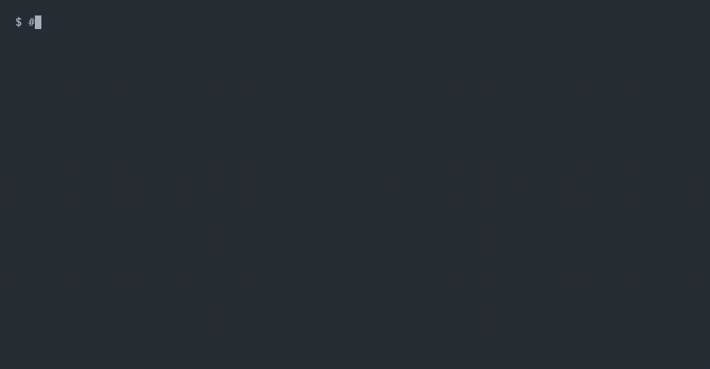

# Handout

[](https://github.com/consolelabs/handout/actions/workflows/ci.yml)
[](https://developers.cloudflare.com/cloudflare-one/connections/connect-networks/)

Handout is a [Console Labs](https://console.so) product. Hand out a file, a folder, a guide, a deck, a build or a dev server at a link on your own domain. The link expires when you say so, counts who opened it, can be private, and a folder gets a page of its own. Like ngrok, but the hostname is yours and stays the same.

## Who it is for

Handout is for people who send things to other people and want the link to look like theirs.

| You hand out | To | What you get |
|---|---|---|
| A file | A client or a teammate | `https://s.example.com/<id>/report.pdf`, public or private to named emails, gone after 7 days |
| A folder, a guide, a deck | A team or a class | One link with a generated page: videos play inline, images show as a grid, files list with type and size |
| A build or a prototype | Testers | A snapshot link that survives deleting the source, refreshed under the same link |
| A running dev server | A reviewer | `handout add 3000` proxies `127.0.0.1:3000` while it runs |
| Anything, from a whole team | Everyone you work with | One hostname, one shared list, each teammate publishing from their own machine |

It is a bash CLI that runs on your machine and on your own Cloudflare account. There is no Handout server and no account to create with us. The CLI is open source. Paid layers are planned: see [docs/product/DIRECTION.md](docs/product/DIRECTION.md).

## Quick start

```sh
brew trust consolelabs/tap
brew install consolelabs/tap/handout
handout setup s.example.com     # browser opens for Cloudflare login; Handout does the rest
handout add ./team-guide        # https://s.example.com/62cb50/team-guide/  (copied to clipboard)
```



A second account or hostname on the same machine is a profile, with its own tunnel, port, and login service:

```sh
CLOUDFLARE_API_TOKEN=... handout --profile work setup s.work.example   # no browser: a token for that account
handout --profile work add ./guide                                     # https://s.work.example/62cb50/guide/
handout profiles                                                       # default and work, each with its state (setup --quick works per profile too)
```

## Features

| | |
|---|---|
| **Stable links** | `https://<your-host>/<id>/<name>`; the random id keeps links unguessable |
| **Snapshots** | `handout add <file\|dir>` copies it; the link survives deleting the source. `handout refresh` updates under the same link |
| **Live dev servers** | `handout add 3000` proxies `127.0.0.1:3000` while it runs |
| **Own hostname per share** | `--host dev.example.com` for apps that emit absolute paths |
| **Folder page** | folders without `index.html` get a generated page: videos play inline, images show as a click-to-enlarge grid, other files list with type and size, all grouped by folder (`--no-index` to refuse) |
| **Markdown rendering** | with pandoc, `.md` renders in [Spacedown](https://github.com/consolelabs/spacedown)'s paper reading theme (light/dark, KaTeX math) |
| **Safe copy** | dotfiles (`.env`, `.git`) and symlinks are never copied |
| **Expiry** | 30 days by default; `--ttl 12h\|7d\|never` |
| **Visitor counts** | `handout hits <id>`: requests and unique IPs |
| **No domain needed** | `handout setup --quick` serves at a random `trycloudflare.com` URL |
| **Agent-native** | `handout skill --install` drops a SKILL.md for Claude Code and friends |
| **Always on** | a login service (launchd/systemd) brings links back after reboot |
| **Menu bar app** | Handout Bar shows what's shared and lets you drag a file onto the icon to publish it |
| **Profiles** | `handout --profile work ...` runs a second setup (another account or hostname) beside the first, on its own port and service |
| **Private links** | `--access email:a@x,b@y`, `domain:example.com`, or `group:<rule group>` puts a Cloudflare Access login (one-time PIN) on one link; the other links stay public. See [Private links](#private-links) |
| **One hostname per tenant** | local by default; the admin can turn R2 on at the origin (`setup <host> --r2 --bucket <name>`) and each link picks local or cloud (`add --cloud`). See [One hostname per tenant](#one-hostname-per-tenant) |
| **Members** | `handout member add ana --machine` prints one `handout join <host> <code>` line; the teammate's links then stay on their own machine under your hostname. Add, list, pause, resume, rotate, renew and remove from one admin CLI. See [Members](#members) |
| **Links with the machine off** | `setup <host> --backend r2 --bucket <name>`: snapshots live in a private R2 bucket, a Worker serves them, and a whole team publishes to one hostname. See [R2 backend](#r2-backend-links-that-stay-up-while-the-machine-is-off) |

On the default tunnel backend, links are live only while the machine is awake; visitors get Cloudflare 530 when it sleeps. `https://<hostname>/healthz` answers `ok` while Handout is serving; the site root 404s by design.

## How it works

```
visitor                                              your machine
───────                                              ────────────────────────────
https://s.example.com/62cb50/guide/                  ~/share/pub/62cb50/guide/
       │                                                          ▲ files
       ▼                                                          │
Cloudflare edge ──── outbound Tunnel ────▶ cloudflared ──▶ caddy on 127.0.0.1:8787
TLS, DNS                                 login service    no-store, noindex
```

`handout add` copies into `~/share/pub`, caddy serves it on localhost, and an outbound Cloudflare Tunnel publishes it at your hostname. Nothing outside `~/share/pub` is reachable, no inbound port opens, and the tunnel token lives in the Keychain (or a mode-600 file on Linux). Detail: [docs/how-it-works.md](docs/how-it-works.md). The folder keeps the name `~/share` from the first releases, so installs from before the rename keep working: [docs/team/development.md](docs/team/development.md#names-kept-from-the-share-era).

## Install

```sh
brew trust consolelabs/tap                # once: current Homebrew refuses formulae from an untrusted tap
brew install consolelabs/tap/handout    # macOS and Linux; pulls caddy, cloudflared, jq
```

Optional extras: `brew install pandoc gh` (markdown rendering, private-repo warning).

No Homebrew:

```sh
curl -fsSL https://raw.githubusercontent.com/consolelabs/handout/main/install.sh | bash
```

From a clone: `git clone https://github.com/consolelabs/handout.git && cd handout && ./install.sh` (symlinks `bin/handout`, so `git pull` updates it).

The tool was called `share` before. `share` stays a working alias for existing installs, so `share add`, `share join <host> <code>` and `share leave` keep working.

Moving an existing Homebrew install of `share`: run `brew update`, which moves it to `consolelabs/tap/handout` (the old tap carries a migration), then `brew trust consolelabs/tap`. `share` keeps working throughout and login services are unaffected.

```sh
brew update && brew trust consolelabs/tap
```

Upgrade later with `brew upgrade consolelabs/tap/handout`.

## Commands

```sh
handout setup s.example.com   # one-time: tunnel, DNS, login service (--quick: no domain; --no-service: no login service)
handout add <file|dir|port>   # publish, print + copy the link
handout add ... --access <rule>   # a login gate on this link: email:a@x,b@y | domain:example.com | group:<name>
handout api-token             # once per profile, the Cloudflare API token --access needs (--cmd '<command>' | --check)
handout config ttl 7d                    # the add expiry default (also: storage_default local|cloud; --unset drops it; no value prints it)
handout admin-token --cmd '<command>'   # the command that prints the admin token for setup --r2, --no-r2, --purge (--clear | --test)
handout minter-token --cmd '<command>'  # the command that prints the token that mints member tokens (--clear | --test)
handout ls                    # shares with link, size, source, expiry
handout refresh <id|link>     # re-copy from source under the same link
handout rm <id|link>          # unpublish (copy goes to Trash)
handout hits <id|link>        # request and visitor counts
handout state                 # JSON snapshot for the menu bar app
handout version               # the CLI version (X.Y.Z)
handout status                # server state plus the share list
handout prune                 # unpublish expired shares now (also hourly while serving)
handout skill --install       # drop a SKILL.md so a coding agent can use Handout
handout member add <name> --machine   # admin: invite a teammate (see Members); the teammate runs handout join <host> <code>
handout stop | start          # take all links down / bring them back
handout teardown [--yes]      # remove tunnel, service, and config; the shares on disk stay
handout --profile <name> ...  # any command against another setup (or SHARE_PROFILE=<name>); handout profiles lists them
handout setup <host> --backend r2 --bucket <name>   # serve from a private R2 bucket through a Worker (see below)
handout setup <host> --r2 --bucket <name>   # on a tunnel profile's origin: R2 on, per-link storage (--alias <old-host> folds an old r2 hostname in; --no-r2 rolls back)
handout add --cloud|--local <file|dir>   # R2 on: this link in the bucket, or on this machine
handout migrate --to <ssh-target>        # move a tenant's origin (R2 off) to another machine, links kept
```

A share from a private GitHub repo prints a warning; the content is public to anyone with the link.

## Private links

Share a link that only named people can open (Cloudflare Access, email one-time PIN). This needs a named setup (`handout setup <hostname>`, not `--quick`) on a Cloudflare account with Zero Trust enabled. If that host is not your default profile, put `--profile <name>` before the verb in every command below.

1. Give share a Cloudflare API token, once per profile.

   Already have a token with Access permissions (Apps and Policies Edit; Organizations, Identity Providers, and Groups Read; Zone Read)? Point share at it:

   ```sh
   handout api-token --cmd 'op read "op://Private/cloudflare token/credential"'
   ```

   Otherwise run `handout api-token`: it opens the Cloudflare token form with those permissions filled in. Click Create, paste the token, done. share checks the permissions either way.

2. Publish for named people:

   ```sh
   handout add ./report.pdf --access email:a@example.com,b@example.com
   ```

   or for everyone at one email domain: `--access domain:example.com` (share warns that this admits every address at the domain, contractors included). The link prints once Cloudflare enforces the login, which can take a few minutes the first time; Ctrl-C during the wait is safe, nothing is published.

3. Next step, a reusable list: create a rule group once in the Cloudflare dashboard (Zero Trust > Access controls > Policies > Rule groups > Add a group; include each person's email), then:

   ```sh
   handout add ./report.pdf --access group:<group name>
   ```

`handout rm` of a gated link removes its Access app too (it needs the same token). A link that expires while nobody holds the token keeps its app in a waiting list; `handout status` shows the count and the next `handout prune` with the token clears it. Detail: [docs/how-it-works.md](docs/how-it-works.md#a-gated-share---access), scopes and troubleshooting: [docs/setup.md](docs/setup.md#4e-private-links-the-api-token-for---access).

## R2 backend: links that stay up while the machine is off

A profile can serve from Cloudflare instead of your machine. `handout add` uploads the snapshot to a private R2 bucket, and a Worker on your hostname serves it. Links answer while the laptop sleeps, and several people publish to one hostname, each from their own machine with their own token.

```sh
CLOUDFLARE_API_TOKEN=<admin token> handout --profile df setup f.example.com --backend r2 --bucket share-f   # admin, once per hostname
handout --profile df add ./report.pdf                                                                      # https://f.example.com/<id>/report.pdf
```

The admin run creates the bucket, deploys the Worker, turns its `workers.dev` route off, and attaches the hostname. A teammate runs the same `setup` line with a token scoped to that one bucket: it prints `joining as publisher` and writes nothing on Cloudflare. Then the teammate stores the token with `handout --profile df api-token`. Token scopes and the step-by-step onboarding: [docs/setup.md](docs/setup.md#4f-r2-backend-admin-setup).

| | tunnel profile | r2 profile |
|---|---|---|
| Links while the machine is off | Cloudflare 530 | served |
| Who publishes | the one machine in `hosts` | anyone holding a publisher token for the bucket |
| `add <file\|dir>`, `ls`, `rm`, `hits`, `prune` | yes | yes; any publisher can `rm` any share |
| `refresh` | yes | only from the install that added the share |
| `add --access` | yes | yes, once the admin setup read the Access team |
| `add <port>` (live), `--host`, `setup --quick` | yes | refused: live dev servers stay on a tunnel profile |
| `start`, `stop`, `serve`, `service` | yes | refused: nothing runs on this machine |

One add holds at most 500 files (`SHARE_R2_MAX_FILES`), each at most 300 MiB. A tunnel profile and an r2 profile run side by side on one machine, so `handout add 3000` keeps working on the tunnel one.

`handout --profile df teardown` on an r2 profile is local: it forgets this install's token and config, and the bucket, the Worker, and every share stay for the other publishers. `CLOUDFLARE_API_TOKEN=<admin token> handout --profile df teardown --yes --purge` deletes every share (gated ones with their Access apps), the Worker, its domain, and the bucket once it is empty, for everyone. Detail: [docs/how-it-works.md](docs/how-it-works.md#r2-backend).

## One hostname per tenant

A tenant is one hostname with one shared list. By default every link is served from the origin machine's disk through its tunnel, exactly as above. The tenant admin can turn R2 on at the origin; after that each link picks local or cloud, and a teammate can publish from another machine.

```sh
CLOUDFLARE_API_TOKEN=<admin token> handout setup s.example.com --r2 --bucket share-s     # on the origin, once
handout add ./report.pdf              # the tenant default (local unless --storage-default cloud)
handout add --cloud ./report.pdf      # in the bucket: answers while the origin is off
handout add --local ./notes           # on the origin's disk
```

| | R2 off (default) | R2 on |
|---|---|---|
| Hostname | one | the same one; storage is a badge on the row |
| Link while the origin is off | Cloudflare 530 | cloud links serve; machine links answer a 503 offline page |
| Who publishes | the origin | the origin (local or cloud), members (their own machines or cloud; see [Members](#members)) |
| Live dev servers, `--host` | yes | yes, on the origin |
| Rollback | none needed | `setup <host> --no-r2` deletes the route; the tunnel serves alone again |

`setup <host> --r2 --bucket <name> --alias <old-host>` folds a former r2 hostname into the tenant: the old name answers 301 to the same path and each gated link keeps its Access app. `handout migrate --to <ssh-target>` moves an R2-off tenant to another always-on machine with every link kept, and prints the rollback line if a step fails. Handout Bar shows one section per tenant, and each row carries a storage badge, a file-type icon, the link type, and a lock for gated links. Admin steps, tokens, and rollbacks: [docs/setup.md](docs/setup.md#4h-one-hostname-per-tenant-r2-on-the-origin-the-alias-fold-moving-the-origin); the model: [docs/how-it-works.md](docs/how-it-works.md#tenants-one-hostname-local-or-cloud) and [ADR-0008](docs/decisions/ADR-0008-one-host-per-tenant.md).

## Members

A member is a named teammate registered in the tenant's bucket. A machine member serves links from their own Mac under your hostname: no subdomain, no dashboard visit, and the file never leaves their machine. A cloud member publishes cloud links only.

```sh
handout setup s.example.com --r2 --bucket share-s --members --yes   # admin, once (T2)
handout member add ana --machine                                    # admin: prints one line
# handout join s.example.com <code>
handout join s.example.com <code>                                  # the member pastes it once
handout add ./report.pdf                                           # https://s.example.com/<id>/report.pdf
```

Admin verbs: `member add`, `ls`, `sync`, `rm`, `purge`, `pause`, `resume`, `invite`, `rotate`, `renew`, `adopt`. A member's own verbs: `join`, `leave`. They need the admin token and a separate minter token (`handout admin-token`, `handout minter-token`), and a Worker that has Workers VPC (a beta product), so members are off until `--members`. Members are named teammates only: every member's pages run under one origin, and the bucket token cannot tell members apart. Steps and refusals: [docs/setup.md](docs/setup.md#4i-members-one-line-to-onboard-a-teammates-machine); the model: [docs/how-it-works.md](docs/how-it-works.md#members-one-hostname-many-machines) and [ADR-0009](docs/decisions/ADR-0009-members.md).

## Menu bar app

```sh
brew install --cask consolelabs/tap/handout-bar    # macOS; also pulls the handout formula (after `brew trust consolelabs/tap`)
```

Handout Bar is a menu bar icon for Handout: no terminal needed to see what's shared or to publish something new. Click the icon for the current state and the share list, each with Copy Link, Open in Browser, Refresh, and Remove. Drop a file or folder on the icon to run `handout add` on it.

First run, before anything is set up:

| State | Header | What you can do |
|---|---|---|
| CLI missing | the CLI-not-found header | Copy Install Command |
| Not set up | `Not set up` | Set Up… (hostname, or quick mode with no domain) |
| Stopped | `Stopped` | Start Sharing |
| Serving | `Serving at <host>` | the share list, Stop Sharing |

The app only reads through the CLI (`handout profiles --json`, one call for every profile) and only acts through the CLI's own verbs (`--profile <name>` before each, `default` included); it never touches `~/share` directly. Publishing a file or folder can target any stopped or serving profile, publicly or behind a login rule (`group:`, `email:`, `domain:` on a named setup); the app never sees a Cloudflare token. To see what the app is doing, `log stream --predicate 'subsystem == "foundation.d.share.bar"'` shows every CLI call and action.

Working on Handout Bar: `swift test --package-path mac` runs the unit tests, `bash mac/build.sh <version>` builds the signed app, and `bash mac/compat-check.sh <tag>` decodes today's CLI output with the `ShareBarCore` sources of a release tag, so a shipped Handout Bar keeps working against a newer CLI. `bash mac/shots.sh <scenario> <step file>` starts the app against a fake CLI under `mac/Tests/fixtures/bin/`, replays real clicks through the Accessibility API, and saves a light and a dark screenshot under `docs/verification/`; it needs Accessibility granted to your terminal.

## Docs

New here? Start at [docs/README.md](docs/README.md), the index grouped by reader, then [docs/team/HANDOVER.md](docs/team/HANDOVER.md). To contribute: [CONTRIBUTING.md](CONTRIBUTING.md).

- [docs/setup.md](docs/setup.md): API token setup (no browser), the R2 backend and teammate onboarding, a tenant's R2 and alias fold, members, moving machines, troubleshooting
- [docs/how-it-works.md](docs/how-it-works.md): architecture, config keys, security model, the R2 data model and Worker, members, testing
- [docs/SYSTEM-DESIGN.md](docs/SYSTEM-DESIGN.md), [docs/QUALITY.md](docs/QUALITY.md), [CONTEXT.md](CONTEXT.md): the UML design, the measurable qualities, the glossary
- [docs/product/DIRECTION.md](docs/product/DIRECTION.md): who Handout is for, what stays free, what could be paid, and the open decisions

## License

MIT
