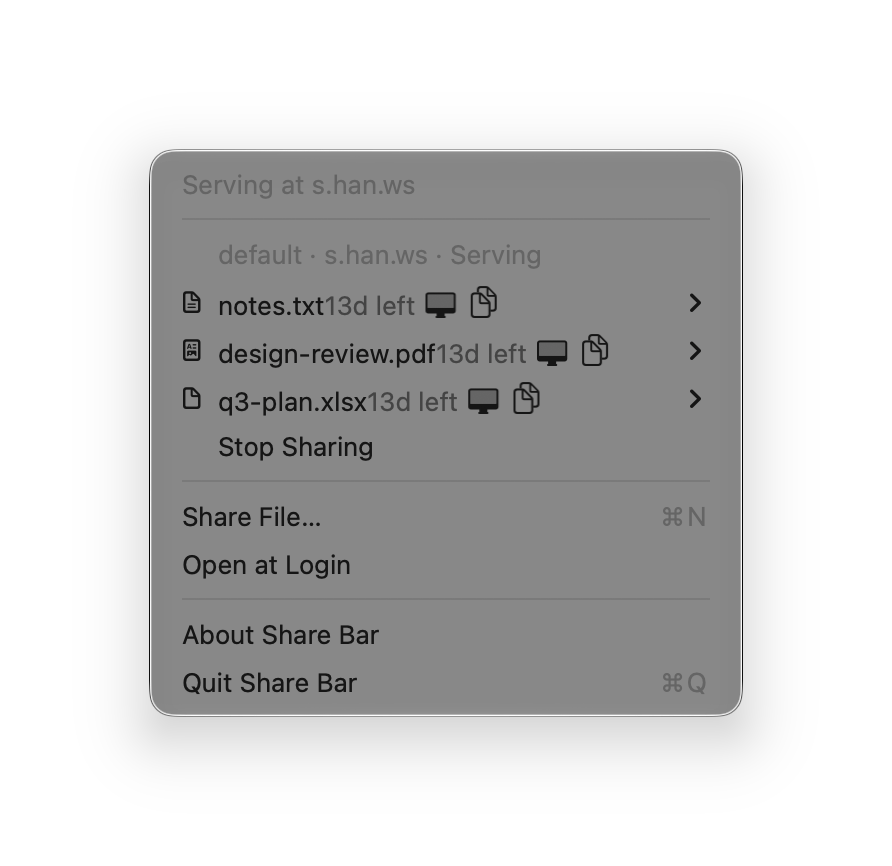
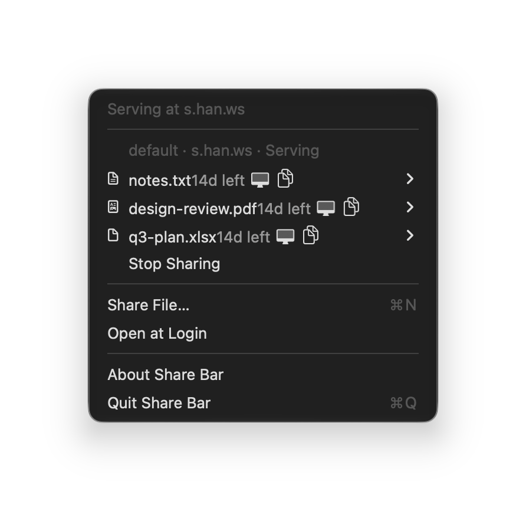
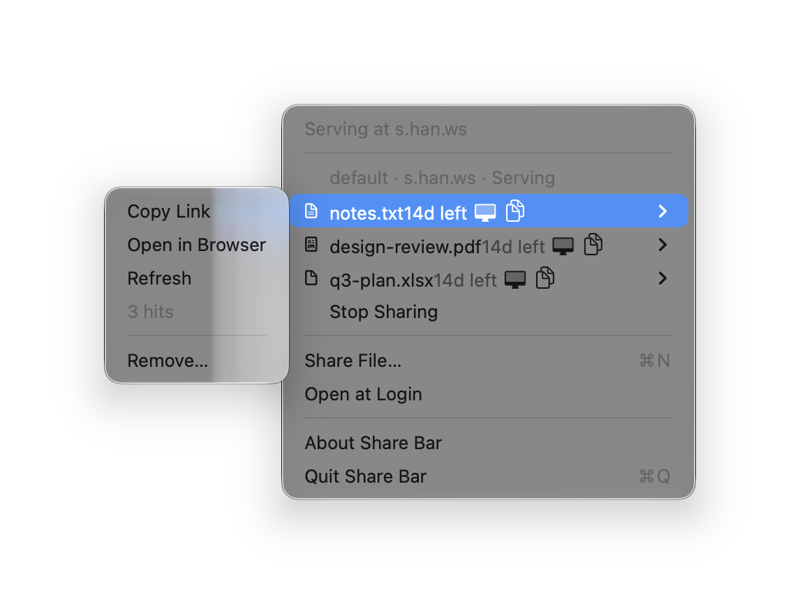
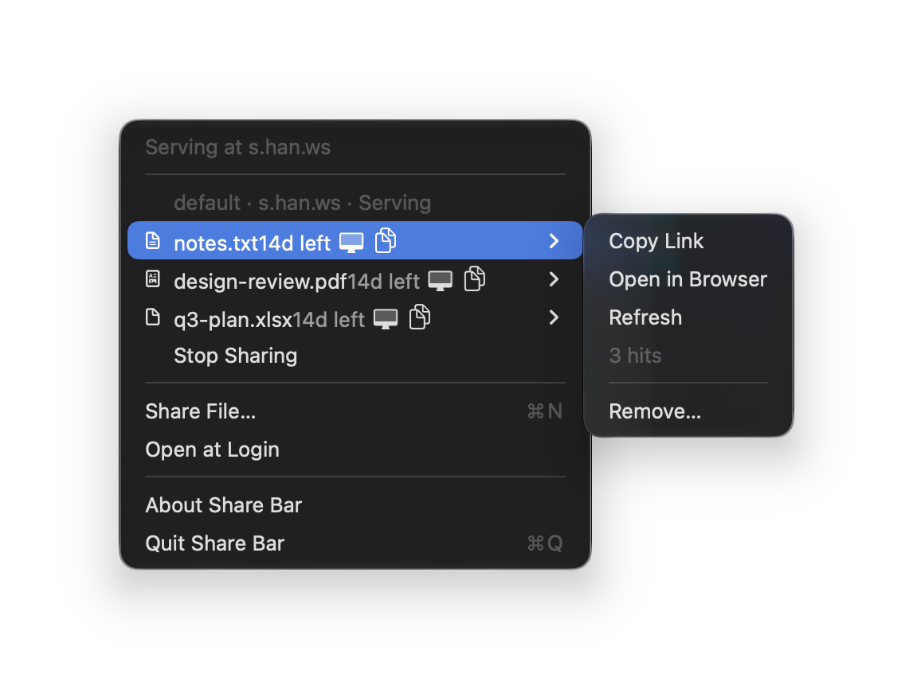
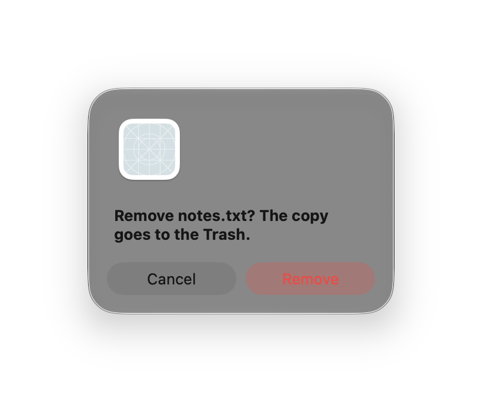
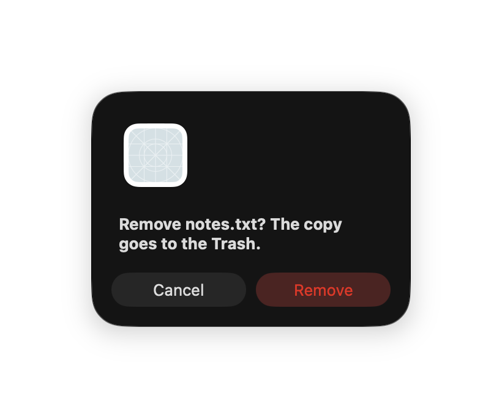

# Proof: Share Bar foundations

Scope: state groundwork G11a, G11b and G11c, and the multi-member tasks 4b1 to 4b5 (decoders, derivation, popover reducer, harness, tokens). `mac/` only; `bin/share` is unchanged. The notes are `docs/implementation-notes/share-bar.md` (decisions D1 to D18 and the AC map).

## Recorded run

All runs on the Mac mini, from the SG-06 worktree, after the last code change. Paths are shortened to the repo root.

```
Command: swift build --package-path mac
Exit: 0
Output:
Building for debugging...
[1 / 1]
Build complete! (0,46 secs)
Verdict: PASS
```

```
Command: swift test --package-path mac
Exit: 0
Output:
	 Executed 258 tests, with 0 failures (0 unexpected) in 5.866 (5.885) seconds
Test Suite 'All tests' passed at 2026-11-15 10:57:28.404.
Verdict: PASS (258 tests, 0 failures)
```

```
Command: bash mac/build.sh 0.0.0
Exit: 0
Output:
Build complete! (4,38 secs)
== assemble Share Bar.app
== sign (ad-hoc)
mac/build/Share Bar.app: replacing existing signature
== zip
mac/build/Share-Bar-0.0.0.zip
Verdict: PASS
```

```
Command: bash mac/compat-check.sh v0.9.0
Exit: 0
Output:
== build ShareBarCore at v0.9.0
== decode 10 fixtures with the v0.9.0 decoder
ok   mac/Tests/ShareBarCoreTests/Fixtures/profiles.json (2 profiles)
ok   mac/Tests/ShareBarCoreTests/Fixtures/profiles-tenant.json (3 profiles)
ok   mac/Tests/ShareBarCoreTests/Fixtures/state.json (1 profile)
ok   mac/Tests/ShareBarCoreTests/Fixtures/state-full.json (1 profile)
ok   mac/Tests/fixtures/scenarios/admin/profiles.json (3 profiles)
ok   mac/Tests/fixtures/scenarios/calm/profiles.json (1 profile)
ok   mac/Tests/fixtures/scenarios/firstrun/profiles.json (1 profile)
ok   mac/Tests/fixtures/scenarios/member/profiles.json (1 profile)
ok   live/profiles.json (3 profiles)
ok   live/state.json (1 profile)
Verdict: PASS (every fixture reads clean with the v0.9.0 decoder)
```

```
Command: bash mac/compat-check.sh v0.9.0 bad-fixture.json  (negative control: a state with schema 2)
Exit: 1
Output:
ok   mac/Tests/fixtures/scenarios/member/profiles.json (1 profile)
ok   live/profiles.json (3 profiles)
ok   live/state.json (1 profile)
FAIL bad-fixture.json: newer: Update Share Bar
Verdict: PASS (the check fails, as it must)
```

```
Command: bash mac/shots.sh calm open-popover
Exit: 0
Output:
== build (debug)
== calm / open-popover
wrote docs/verification/share-bar/4b4-open-popover-dark.png
wrote docs/verification/share-bar/4b4-open-popover-light.png
argv.log (light): profiles --json;profiles --json;
Verdict: PASS
```

```
Command: bash mac/shots.sh calm missing-control  (negative control)
Exit: 1
Output:
== build (debug)
== calm / missing-control
shots.sh: step 4 (click No Such Control): missing control: No Such Control
Verdict: PASS (fails naming the control, no image written)
```

```
Command: bash mac/shots.sh calm remove-link
Exit: 0
Output:
== build (debug)
== calm / remove-link
wrote docs/verification/share-bar/4b4-remove-confirm-dark.png
wrote docs/verification/share-bar/4b4-remove-confirm-light.png
wrote docs/verification/share-bar/4b4-row-menu-dark.png
wrote docs/verification/share-bar/4b4-row-menu-light.png
argv.log (light): profiles --json;profiles --json;--profile default hits 7c1d20;--profile default hits 4f9ff2;--profile default rm 4f9ff2;profiles --json;
Verdict: PASS (argv.log holds `rm 4f9ff2`)
```

```
Command: bash mac/shots.sh all
Exit: 0
Output:
== build (debug)
== calm / missing-control: failed as required, no image
== calm / open-popover
wrote docs/verification/share-bar/4b4-open-popover-dark.png
wrote docs/verification/share-bar/4b4-open-popover-light.png
argv.log (light): profiles --json;profiles --json;
== calm / remove-link
wrote docs/verification/share-bar/4b4-remove-confirm-dark.png
wrote docs/verification/share-bar/4b4-remove-confirm-light.png
wrote docs/verification/share-bar/4b4-row-menu-dark.png
wrote docs/verification/share-bar/4b4-row-menu-light.png
argv.log (light): profiles --json;profiles --json;--profile default hits 7c1d20;--profile default hits 4f9ff2;profiles --json;--profile default rm 4f9ff2;profiles --json;
Verdict: PASS
```

```
Command: /bin/bash -n mac/shots.sh; /bin/bash -n mac/compat-check.sh; /bin/bash -n mac/Tests/fixtures/bin/share; shellcheck mac/shots.sh mac/compat-check.sh mac/Tests/fixtures/bin/share
Exit: 0
Output:
parse ok under bash 3.2.57: mac/shots.sh
parse ok under bash 3.2.57: mac/compat-check.sh
parse ok under bash 3.2.57: mac/Tests/fixtures/bin/share
shellcheck: no findings
Verdict: PASS
```

## Done line

- Journal `rerun_argv` and `rollback_argv`: `JournalRunTests` (17 rows) covers the verb and profile checks, the per-verb flag shapes, a hostile argument reaching a stand-in CLI as one literal argument with no shell, and an op of unknown liveness never running.
- `member ls --json` and the progress line decode from fixtures built to the spec's shapes: `NewKeyDecodeTests` with `member-ls.json` and `state-full.json`.
- Each AC row maps to a test or a run in the AC map of the notes.

## Screenshots

Taken by `bash mac/shots.sh`, every control reached by a real mouse click through the Accessibility API; nothing sets state in the app.

- The menu a click on the status item opens, light then dark:  
- The row menu:  
- The remove confirm:  

The light images read grey because `screencapture -l` takes the translucent menu window alone, with no backdrop to blur (notes D8).

## UAT

Ran `mac/shots.sh` and `mac/compat-check.sh` on the Mac mini against the fake CLI and a throwaway HOME. Accepted. A collapsed Hidden Bar hides every third-party status item on this machine; `shots.sh` expands it once when the item is missing (notes D10).

## Not attempted

- The "drag from Finder" step and the screenshots index `docs/verification/multi-member.md` (notes D17).
- A caller of `JournalRun` in the menu (notes D16).
